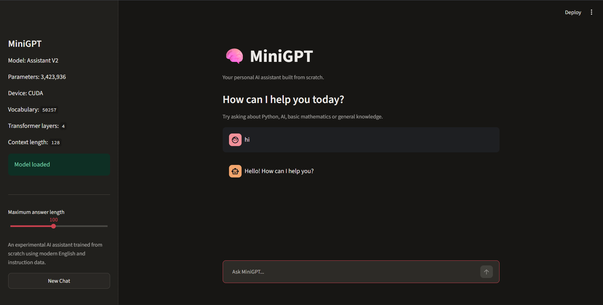

# MiniGPT From Scratch

A GPT-style language model implemented and trained from scratch using Python, PyTorch and CUDA, with an interactive Streamlit chat application.

## Project Overview

MiniGPT is an educational implementation of a decoder-only Transformer language model. The project demonstrates the complete language model development pipeline, from tokenization and neural network architecture to pretraining, supervised instruction fine-tuning, evaluation and local inference.

All model weights were trained from scratch without using a pretrained language model or external LLM API.

## Key Features

- Custom GPT-style Transformer implementation using PyTorch.
- 3.42 million trainable parameters.
- Causal multi-head self-attention.
- Learned token and positional embeddings.
- Residual connections, layer normalization and GELU activation.
- Weight tying between token embeddings and the output layer.
- GPU-accelerated training using CUDA.
- Supervised instruction fine-tuning with answer-only loss masking.
- Interactive Streamlit chat application.

## Model Architecture

| Component | Configuration |
|---|---|
| Architecture | Decoder-only Transformer |
| Trainable parameters | 3,423,936 |
| Vocabulary size | 50,257 |
| Context length | 128 tokens |
| Embedding dimension | 64 |
| Transformer blocks | 4 |
| Attention heads | 4 |
| Feed-forward dimension | 256 |
| Activation | GELU |
| Tokenizer | GPT-2 BPE via Tiktoken |
| Optimizer | AdamW |

### Architecture Flow

```text
Input Text
    |
    v
GPT-2 Tokenizer
    |
    v
Token + Positional Embeddings
    |
    v
4 Transformer Blocks
    |
    v
Final Layer Normalization
    |
    v
Vocabulary Prediction Layer
    |
    v
Autoregressive Text Generation
    |
    v
Streamlit Chat Interface
```

## Training Pipeline

### Language Model Pretraining

The model was pretrained on the Tiny Shakespeare dataset using next-token prediction and cross-entropy loss.

Training started with an initial 500-step experiment, followed by continued training targeting 2,000 total optimization steps.

### Instruction Fine-Tuning

The pretrained model was fine-tuned on question-answer examples covering Python, artificial intelligence, general knowledge, greetings and arithmetic.

The instruction-training process uses answer-only loss masking to train the model to generate assistant responses rather than reproduce user questions.

Assistant V2 was trained for 1,500 instruction fine-tuning steps.

## Experimental Results

### Language Model Performance

| Metric | Initial Model | Continued Training |
|---|---:|---:|
| Validation loss | 6.1359 | 5.2930 |
| Perplexity | 462.16 | 198.93 |
| Next-token accuracy | 16.70% | 20.81% |

Continued language-model training reduced validation perplexity by approximately **57%** and increased next-token accuracy by **4.11 percentage points**.

Both evaluations covered 35,840 validation token positions.

### Assistant V2 Evaluation

The final assistant was evaluated on 104 held-out questions.

| Metric | Result |
|---|---:|
| Total questions | 104 |
| Correct answers | 6 |
| Exact-match accuracy | 5.77% |
| Knowledge questions | 2/4 |
| Arithmetic questions | 4/100 |
| Empty responses | 0 |

These results highlight the limitations of a small language model trained on limited data. The model demonstrated some conversational behavior but struggled with generalization and arithmetic reasoning.

The pretraining perplexity improvement should not be interpreted as an improvement in assistant question-answering accuracy.

## Streamlit Application

MiniGPT includes a local chat interface for interacting with the final Assistant V2 model.

The application supports:

- Interactive user and assistant messages.
- Local GPU or CPU inference.
- Conversation history displayed in the interface.
- New Chat functionality.
- Adjustable generation length.



## Installation

Clone the repository:

```bash
git clone https://github.com/shreyanshprasad2025/MiniGPT-from-Scratch.git
cd MiniGPT-from-Scratch
```

Create a virtual environment:

```bash
python -m venv .venv
```

Activate the environment on Windows PowerShell:

```powershell
.\.venv\Scripts\Activate.ps1
```

Install dependencies:

```bash
python -m pip install -r requirements.txt
```

For GPU acceleration, install a CUDA-enabled PyTorch version compatible with your hardware.

## Run MiniGPT

Place the final Assistant V2 checkpoint in the checkpoints directory:

```text
checkpoints/minigpt_assistant_v2.pt
```

Start the application:

```bash
python -m streamlit run app.py
```

Open the following URL in your browser:

http://localhost:8501

The trained checkpoint is not included in the source repository. It must be downloaded separately from the project's release assets once published.

## Technologies

- Python
- PyTorch
- CUDA
- NumPy
- Tiktoken
- Streamlit

## Training Hardware

- NVIDIA GeForce RTX 4050 Laptop GPU
- 6 GB GPU memory
- 16 GB system RAM

## Limitations

MiniGPT is a small educational language model, not a production-ready general-purpose assistant.

- Limited factual knowledge.
- Low accuracy on unseen arithmetic questions.
- May generate repetitive, incorrect or irrelevant answers.
- Limited context window of 128 tokens.
- Conversation history is displayed in Streamlit, but the model receives only the latest user question.
- Performance is constrained by training data, model size and computational resources.

## Learning Outcomes

Through this project, I gained practical experience with:

- Tokenization and text preprocessing.
- Neural network training and backpropagation.
- Transformer architecture and causal attention.
- GPU-accelerated machine learning.
- Checkpoint management and model evaluation.
- Supervised instruction fine-tuning.
- Local deployment of a generative AI model.

## References

- Sebastian Raschka, Build a Large Language Model (From Scratch): https://github.com/rasbt/LLMs-from-scratch
- Tiny Shakespeare: https://github.com/karpathy/char-rnn/tree/master/data/tinyshakespeare
- PyTorch: https://pytorch.org/
- Streamlit: https://streamlit.io/

## Author

An independent AI/ML learning and portfolio project focused on understanding language models from first principles.